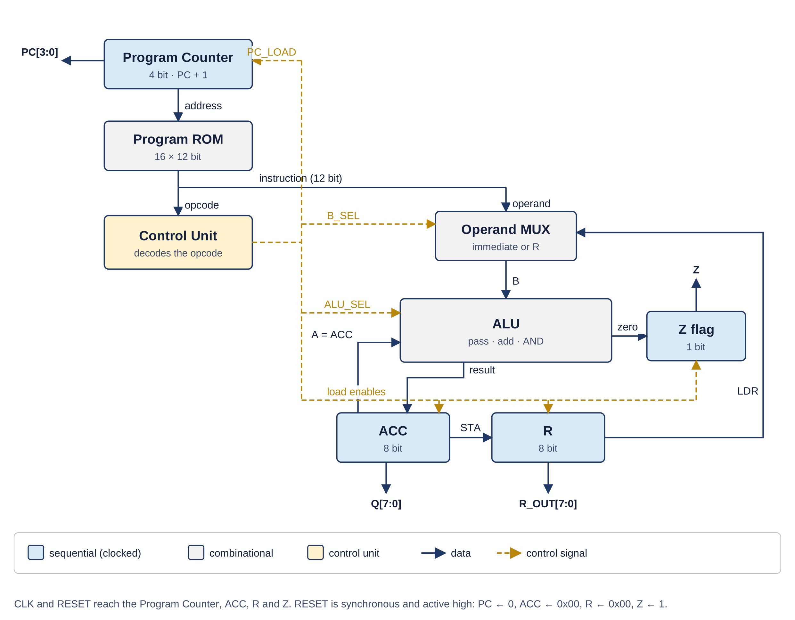

# CSE 450 - Design and Testing of VLSI Lab

**University of Asia Pacific**  
Department of Computer Science and Engineering  
**Semester:** Spring 2026  

---

## Student Information
**Name:** Lubaba Hasan  
**Section:** AB2 

## Instructor Information
**Name:** Md Rasheduzzaman  
**Designation:** Lecturer 

## Repository Overview

This repository documents VHDL-based digital circuit design and implementation work done for the CSE 450 VLSI lab course. The projects progress from basic arithmetic circuits and sequential storage to an arithmetic and logic unit (ALU) and a single-cycle 8-bit accumulator-based CPU. Source files, simulation materials, and project documentation are organized by implementation.

## Repository Contents

| Directory / File | Description |
|---|---|
| [Full-adder-1bit](Full-adder-1bit/) | One-bit full-adder design and implementation. |
| [Full-adder-8bit](Full-adder-8bit/) | Eight-bit adder design and implementation using multi-bit carry propagation. |
| [Register-8bit](Register-8bit/) | Eight-bit sequential data-storage design and implementation. |
| [ALU-8bit](ALU-8bit/) | Eight-bit arithmetic and logic unit design and implementation. |
| [CPU-8-bit](CPU-8-bit/) | Single-cycle 8-bit accumulator CPU design and implementation. |
| [CPU_Visualization.html](CPU_Visualization.html) | Interactive HTML resource illustrating instruction execution, register updates, and internal datapath behavior (AI-generated; see [note](#note-on-ai-generated-content)). |

## Final Project: 8-Bit Accumulator CPU

The final project implements a single-cycle, 8-bit accumulator-based processor in VHDL.

### Architecture

| Component | Description |
|---|---|
| Program counter | 4-bit |
| Program ROM | 16-word × 12-bit |
| Control unit | Combinational |
| ALU | 8-bit |
| `ACC` | Accumulator register |
| `R` | Data register |
| `Z` | Zero flag |

The processor uses a synchronous active-high reset and updates its sequential state on rising clock edges.

### Block Diagram

  

<em>Figure 1: Block diagram of the single-cycle 8-bit accumulator CPU.</em>

### Instruction Set - Set 4

| Instruction | Opcode | Operation |
|---|---|---|
| `LDI imm` | `0001` | `ACC ← imm` |
| `ADD imm` | `0010` | `ACC ← ACC + imm` |
| `AND imm` | `0100` | `ACC ← ACC AND imm` |
| `STA` | `1010` | `R ← ACC` |
| `LDR` | `1011` | `ACC ← R` |

Unrecognized opcodes are treated as no-operation (`NOP`) instructions, advancing the program counter without changing `ACC`, `R`, or `Z`.

### Verification

The CPU testbench uses a 20 ns clock period and a synchronous reset. It executes a ten-instruction program and checks expected outputs using VHDL assertions sampled 1 ns after rising clock edges. Verification covers:

- Immediate loading
- Addition and bitwise AND
- Register transfers
- Program-counter progression
- Zero-flag behavior

## Tools and Methods

| Tool | Purpose |
|---|---|
| **VHDL** | Hardware description and modular implementation |
| **Xilinx ISE** | Project development and simulation |
| **VHDL testbenches** | Functional verification through assertions and waveform inspection |
| **GitHub** | Version control and project documentation |

## Learning Outcomes

This repository is maintained as an academic record of coursework at the University of Asia Pacific. The implementations and accompanying materials are intended to support the study of combinational logic, sequential circuits, hardware integration, and basic processor architecture.

## Acknowledgments

I would like to express my sincere gratitude to **Md Rasheduzzaman**, Lecturer, Department of Computer Science and Engineering, University of Asia Pacific, for his instruction and guidance throughout the CSE 450 VLSI lab course.

## Note on AI-Generated Content

The interactive CPU visualization ([`CPU_Visualization.html`](CPU_Visualization.html)) was **generated with the assistance of an AI tool**. It is provided solely as a supplementary learning aid. It is not a simulation of the VHDL source, is not derived from synthesis or waveform output, and should not be treated as authoritative. The VHDL source files and testbench results in this repository remain the definitive reference for the design's behavior.
